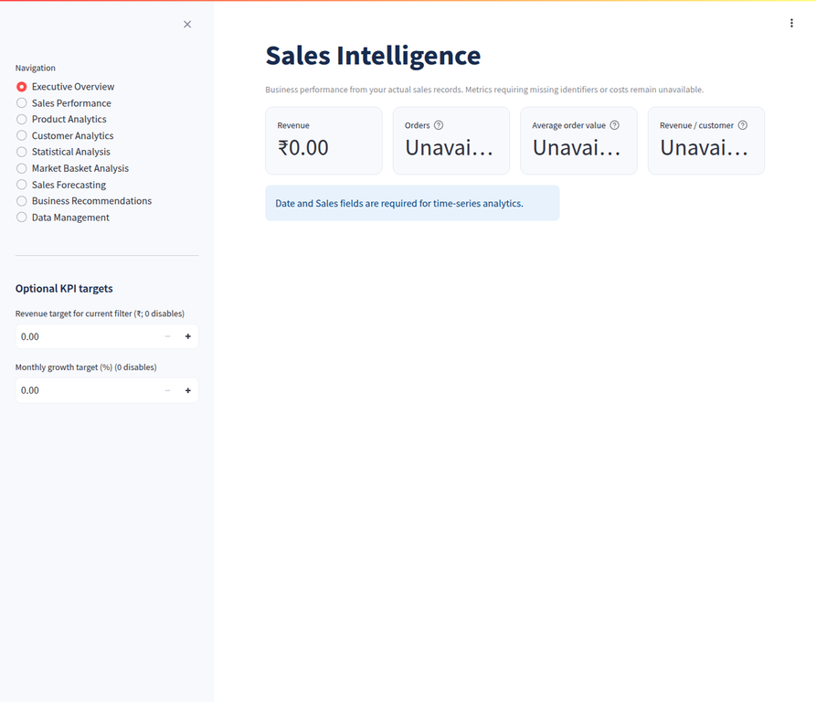
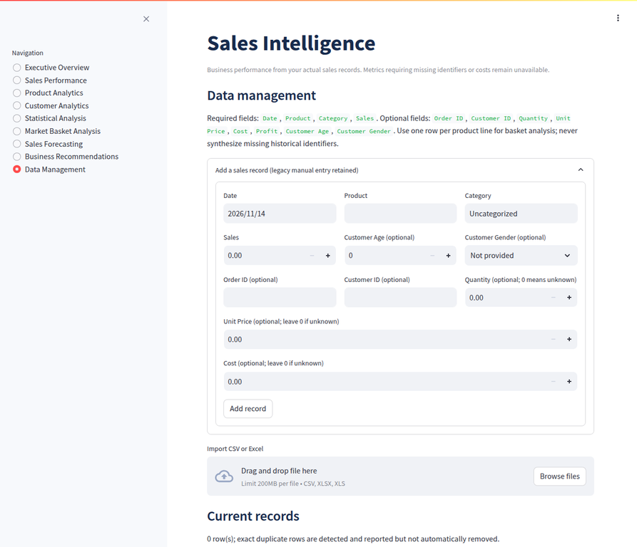
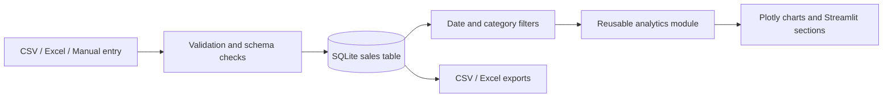

# Sales Intelligence Dashboard

A Streamlit e-commerce BI portfolio project built with Python, Pandas, Plotly, SQLite, SciPy and Statsmodels. It preserves the original manual sales entry and Excel compatibility while adding modular analytics and data management. No sample sales history is bundled, so charts and conclusions reflect only data supplied by the operator.

## Run locally

```bash
git clone https://github.com/riya-73/Sales-Analysis-Dashboard.git
cd Sales-Analysis-Dashboard
python -m venv .venv
# macOS/Linux: source .venv/bin/activate
# Windows: .venv\Scripts\activate
python -m pip install -r requirements.txt
streamlit run E-com.py
```

The local SQLite database is `sales_dashboard.sqlite3` (override with `SALES_DB_PATH`). On first run, if `ecommerce_data.xlsx` exists and the SQLite sales table is empty, the dashboard imports it. The original Excel file is not modified or deleted. Back up the SQLite database before manual database-level edits.

## Navigation

The application includes Executive Overview, Sales Performance, Product Analytics, Customer Analytics, Statistical Analysis, Market Basket Analysis, Sales Forecasting, Business Recommendations, and Data Management. Date-range and category filters are shared across analytical pages. Data Management supports manual entry, CSV/Excel import, validation, duplicate reporting, and CSV/Excel export.

## Implemented analytics

- **Executive summary:** revenue, availability-aware order/AOV/customer KPIs, user-entered optional revenue and growth targets, filtered-data revenue leader, and robust monthly anomaly flags.
- **Sales:** daily/monthly/yearly trends, MoM/YoY changes, robust median/MAD anomaly investigation, and user-selected month-to-month revenue comparisons.
- **Products:** revenue ranking, contribution and cumulative Pareto curve, category revenue comparisons, recent two-month product increase/decrease indicators, and descriptive year-by-month revenue heatmap.
- **Customers:** when `Customer ID`, `Order ID`, and dates exist, distinct-order frequency, RFM-inspired segments, customer revenue contribution, new/single-observed-order versus returning status, repeat purchase rate, and cohort retention heatmap. These metrics respect the dashboard's active filters.
- **Statistics:** descriptive distribution summaries and histogram, IQR and Z-score outlier counts, Student-t 95% confidence interval for average row-level Sales, pairwise Pearson correlation with p-values and Fisher-z confidence intervals, distribution-aware one-way ANOVA or Kruskal–Wallis comparison, and eta-squared/epsilon-squared effect size.
- **Forecasting:** expanding-window rolling-origin one-step forecasts over up to six latest origins; comparison of moving average, exponential smoothing, ARIMA (when each training fold has at least 18 months), and SARIMA (at least 36 months). The model with lowest rolling WAPE is refit for 3/6/12-month forecasts. ARIMA/SARIMA provide model intervals; other models use approximate ranges from rolling residual spread. Residual plots, mean residual and a Ljung–Box check (when enough residuals exist) support diagnostics.

Every analytical result is conditional on usable source data. No sample orders, customers, historical relationships, test findings, recommendations, or model performance are included in the app. Unit-test fixtures are solely for deterministic code verification.

## Dashboard screenshots

These are genuine screenshots of the running app with its database empty; they document the actual empty state and data-entry controls, not fabricated analytical charts. Add a real dataset to display analytical results.





## Data schema and limitations

Required input columns are `Date`, `Product`, `Category`, and `Sales`. Optional columns are `Order ID`, `Customer ID`, `Quantity`, `Unit Price`, `Cost`, `Profit`, `Customer Age`, and `Customer Gender`. Dates must parse as dates and Sales must be numeric. Invalid required dates/Sales rows are removed with warnings; negative Sales values are retained because they may represent refunds. Exact duplicates are flagged, not silently deleted.

The legacy entry schema has no customer or order identifiers. As a result, order counts and genuine order-level AOV, customer revenue/frequency/retention/cohorts, RFM segmentation, and market-basket associations are unavailable until identifiers are supplied. No synthetic identifiers or historical relationships are generated. One row per purchased product line with a shared `Order ID` is needed for basket analysis. For genuine order counts and AOV, `Order ID` must identify an order consistently across its product lines. `Customer ID`, `Order ID`, and dated transactions are necessary for reliable purchase-frequency segmentation; cohort analytics also require these transaction-level observations. Cost or Profit is required for profitability; otherwise the dashboard reports revenue only.

## Analytics methodology

- Revenue growth is calculated from observed periods; zero denominators remain undefined.
- Product and category shares and cumulative revenue concentration are descriptive, not margin measures.
- Customer RFM-like ranks use observed recency (smaller is better), distinct Order ID count and revenue percentiles. “New / single observed order” is not proof of first-ever customer status when prior history is unavailable. Cohort retention measures observed customers active in each cohort month divided by that cohort's size in its first observed month.
- Sales mean confidence intervals use Student's t under independent observations. Pairwise Pearson inference reports unadjusted p-values and Fisher-z intervals; multiple comparisons and dependence can invalidate naive interpretation.
- Category comparisons use Shapiro/Levene diagnostics to choose one-way ANOVA when normality/equal-variance assumptions are plausible; otherwise Kruskal–Wallis with epsilon-squared. ANOVA effect size is eta-squared. Repeated customers/orders, unequal exposure, confounding and multiple-testing correction are not modeled. Interpret the test, uncertainty and effect size together; significance is not business value.
- Outlier investigation includes IQR fences and absolute Z-score > 3; monthly revenue flags use modified median/MAD score ≥ 3.5 and require at least six observed months. Flags identify unusual observations, not causes.
- Forecasting requires at least 14 contiguous observed monthly periods. Expanding-window one-step validation assesses up to six recent forecast origins. MAE, RMSE and WAPE use only held-out origins; no random split is used. The point forecast model is selected by rolling WAPE. ARIMA/SARIMA model confidence intervals are used when selected; moving-average/Exponential Smoothing intervals are approximate 1.96× rolling residual standard deviation, not calibrated prediction intervals. Prophet is omitted because no project dataset supports justifying its additional complexity.
- Empty resampling bins stay missing. Forecasts are withheld when calendar coverage contains gaps; absent source months are not interpreted as zero sales. The app cannot independently establish completeness of the user's source data.
- Recommendations and KPI target indicators are derived from selected real records and user-entered targets; they do not establish causality or profitability.
- Recommendations are derived from measured revenue changes, top/bottom observed products, or qualifying order-level rules; recommendations do not establish causality or profitability.

## Architecture

```text
E-com.py       Streamlit UI, navigation, input validation flow, charts and report downloads
analytics.py  Reusable KPI, growth, product, customer, cohort, basket, statistics and forecast functions
storage.py    SQLite schema, legacy Excel migration, validation, persistence
sales_dashboard.sqlite3  Local persisted observations (generated at runtime; not committed)
```

SQLite is used as the default persistent store. The dashboard is designed for a standard laptop; computations run locally on the currently selected/filtered dataset. Do not commit private customer data or the generated database to a public repository.

## Tests and quality checks

```bash
pytest -q
```

The expanded local suite currently passes **14 tests** covering category hypothesis/effect-size calculations, confidence intervals, correlation handling, customer contribution/cohorts, date and category filtering, selected-period comparison, product change/seasonality/anomaly outputs, empty/missing input, CSV/Excel import/export round-trips, SQLite persistence, and forecast behavior with insufficient and sufficient history. The forecast tests can emit Statsmodels convergence/frequency warnings on test fixtures; the application guards model fitting and does not publish test-fixture results.

## Architecture diagram



## Privacy and scope

The app is a local analytics tool; it does not upload records to a hosted service. Customer identifiers should be pseudonymized where possible. Statistical and forecasting outputs are exploratory decision support, not guarantees or causal conclusions.
